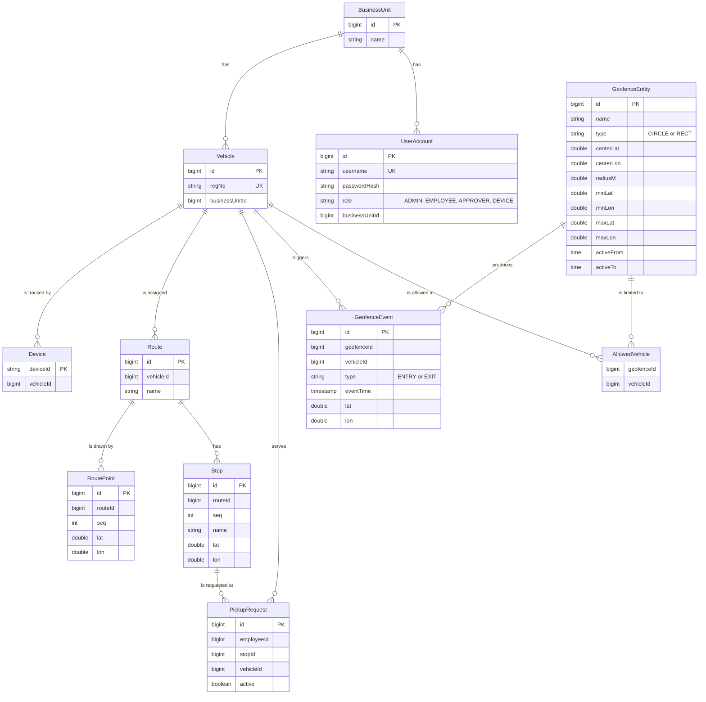
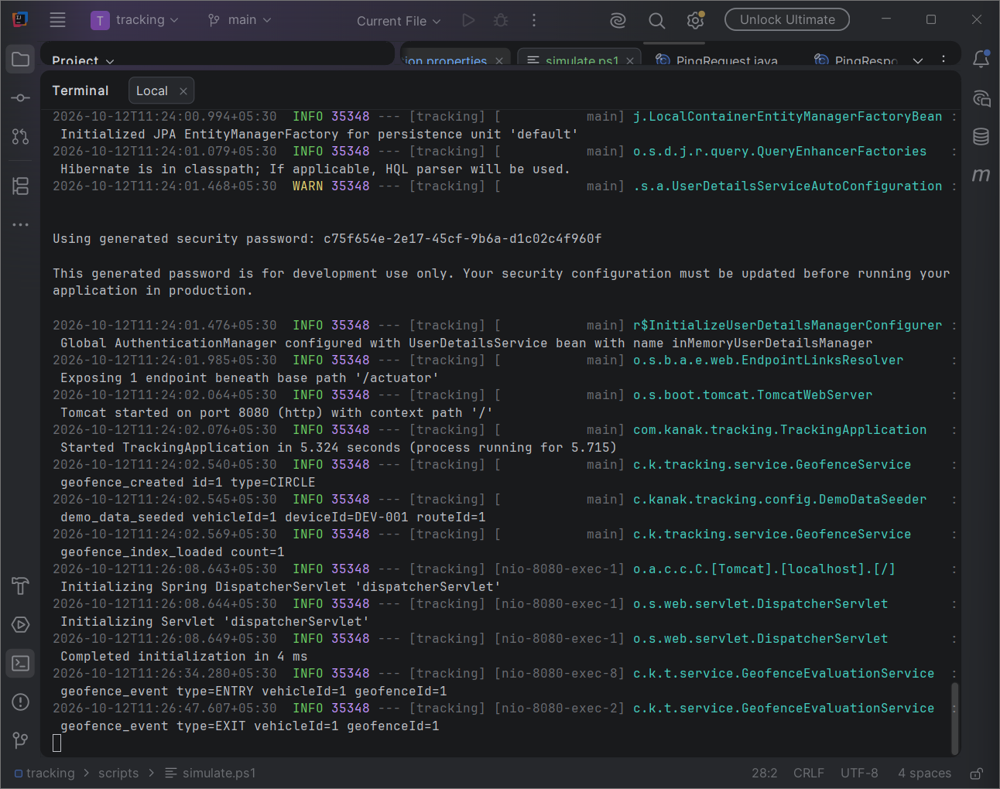
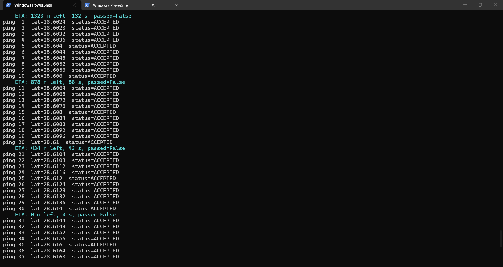
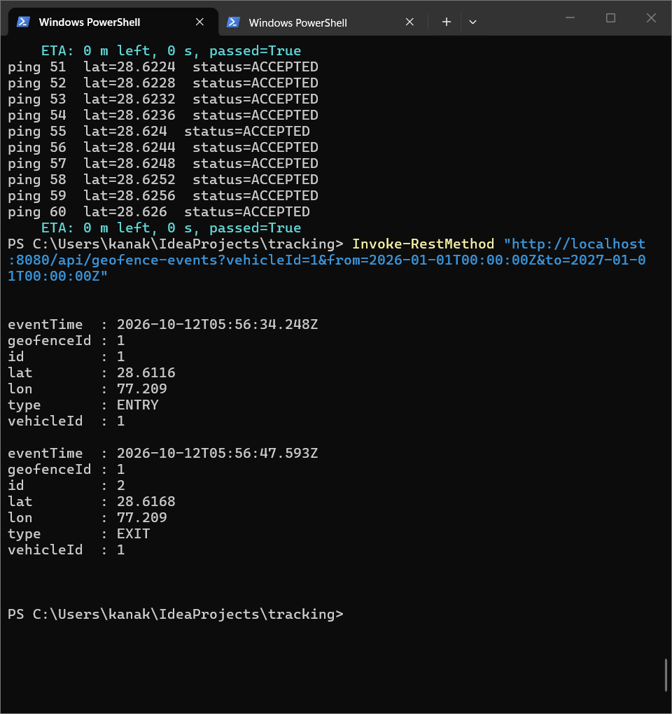
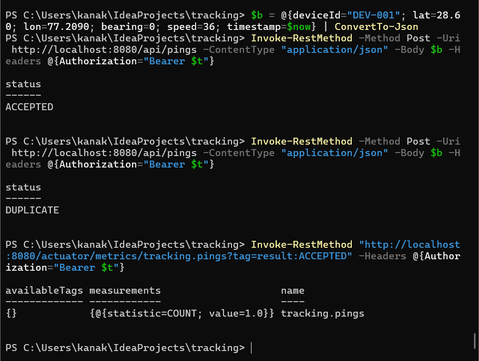
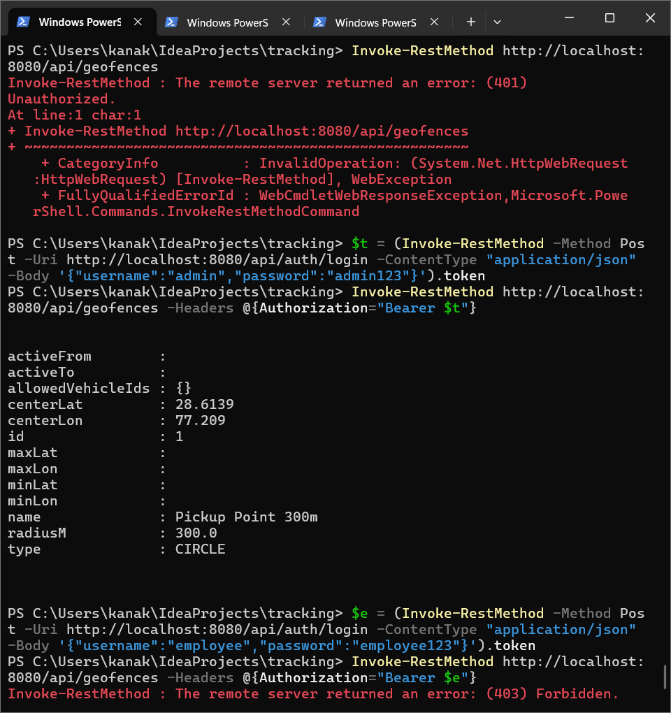

# Live Vehicle Tracking: Geofence Events & ETA

Backend for MoveInSync Case Study 2. It ingests a stream of GPS pings from cabs, keeps each vehicle's latest known position, fires **ENTRY / EXIT geofence events exactly once**, and computes an **ETA to each waiting pickup stop**, while coping with late, out-of-order and duplicate pings.

**Stack:** Java 17, Spring Boot 4.1.1, Spring Data JPA (H2 in-memory), Spring Security (JWT), Caffeine cache, Micrometer / Actuator, JUnit 5 + MockMvc, Maven.

---

## Features

| Area | What is implemented |
|---|---|
| Ping ingestion | Device to vehicle mapping via device registry, dedup on `(deviceId, timestamp)`, an older ping never overwrites a newer fix, stale pings (older than 300 s by default) dropped |
| Geofences | Circle (centre + radius) and rectangle zones, time-windowed zones (including windows that wrap past midnight), vehicle-specific zones |
| Events | ENTRY once on crossing in, EXIT once on leaving, persisted and queryable by vehicle and time range |
| ETA | Snap the GPS point to the planned route, remaining distance / smoothed speed, per pickup stop |
| Scale | Spatial grid index so a ping only checks geofences near it |
| Security | JWT authentication, role-based access (`ADMIN`, `EMPLOYEE`, `APPROVER`, `DEVICE`), BCrypt password hashes |
| Ops | Metrics counters, structured logs, global exception handler, cache for device lookups |

---

## Project structure

```
src/main/java/com/kanak/tracking
├── config/        AppConfig, DemoDataSeeder, UserSeeder
├── controller/    Auth, Geofence, GeofenceEvent, Ping, Vehicle
├── service/       PingIngestionService, GeofenceEvaluationService, EtaService,
│                  GeofenceService, GeofenceEventService, DeviceLookupService,
│                  LiveLocationStore, ZoneStateStore, TrackingMetrics
├── domain/
│   ├── geofence/  Geofence (abstract), CircleGeofence, RectGeofence, BoundingBox, GeoUtils
│   ├── model/     JPA entities and enums
│   └── state/     LocationFix, ZoneState
├── index/         SpatialGridIndex
├── eta/           RouteSnapper, SpeedEstimator
├── security/      JwtService, JwtAuthFilter, SecurityConfig
├── repository/    Spring Data repositories (10)
├── dto/           Request / response objects, ApiError
└── exception/     GlobalExceptionHandler
```

Layering is controller -> service -> repository. Geofence shapes use polymorphism: `CircleGeofence` and `RectGeofence` extend the abstract `Geofence` and each implements `contains(lat, lon)` and `boundingBox()`. The time-window and vehicle-filter rules live once in the base class, so a new shape (for example a polygon) needs no change in the evaluation service.

---

## Data model

The diagram renders on GitHub. Relationships are **logical**: tables reference each other by id columns (for example `vehicleId`), without JPA associations or database foreign keys, see Trade-offs.



Notes:

- `AllowedVehicle` is the collection table JPA creates for `GeofenceEntity.allowedVehicleIds`. An empty set means the zone applies to all vehicles.
- `GeofenceEvent` has a unique constraint on `(geofence_id, vehicle_id, event_time, event_type)`, which makes event writes idempotent.
- `employeeId` in `PickupRequest` is a plain id, there is no employee table because employees are out of scope for this case study.
- Circle zones use `centerLat`, `centerLon`, `radiusM`. Rectangle zones use `minLat`, `minLon`, `maxLat`, `maxLon`. The unused columns stay null.
- Live position, latest fix per vehicle and zone state are kept in memory, not in the database (see Trade-offs).

---

## How to run

**Prerequisites:** JDK 17, Maven 3.9+.

```bash
# run tests
mvn clean test

# start the app (http://localhost:8080)
mvn spring-boot:run
```

With `tracking.seed.enabled=true` (default) the seeders create a demo vehicle (`DEV-001`), a route with a pickup stop, a demo circular geofence and four demo users.

### Demo users

| Username | Password | Role |
|---|---|---|
| `admin` | `admin123` | `ADMIN` |
| `employee` | `employee123` | `EMPLOYEE` |
| `approver` | `approver123` | `APPROVER` |
| `device` | `device123` | `DEVICE` |

These are demo credentials only. Passwords are stored as BCrypt hashes.

### Simulator

With the app running, in a second terminal:

```powershell
.\scripts\simulate.ps1
```

It logs in, then sends 61 pings for `DEV-001` moving towards the pickup (one per second) and prints the ETA every 10 pings. You will see the ENTRY and EXIT events in the app log.

### Configuration

`src/main/resources/application.properties`, plus defaults set in code:

| Property | Default | Meaning |
|---|---|---|
| `tracking.seed.enabled` | `true` | Create demo data on startup |
| `tracking.jwt.secret` | dev-only value | Override with the `JWT_SECRET` environment variable in any real deployment |
| `tracking.jwt.expiry-minutes` | `60` | Token lifetime |
| `tracking.ping.stale-seconds` | `300` | Pings older than this are rejected as `STALE` |
| `tracking.eta.alpha` | `0.3` | Weight of the newest speed reading in the moving average |
| `tracking.eta.min-kmh` | `5` | Speed floor, so a red light does not give an infinite ETA |
| `tracking.eta.default-kmh` | `20` | Speed used before any reading exists |
| `tracking.eta.traffic-factor` | `1.0` | Multiplier on speed (0.8 = 20% slower) |
| `spring.cache.caffeine.spec` | `maximumSize=10000,expireAfterWrite=10m` | Device cache size and TTL |

---

## API and roles

All endpoints except login and `/actuator/health` need `Authorization: Bearer <token>`.

| Method | Path | Roles | Purpose |
|---|---|---|---|
| POST | `/api/auth/login` | public | Returns `token`, `role`, `expiresInSeconds` |
| POST | `/api/pings` | `DEVICE`, `ADMIN` | Submit a GPS ping |
| POST / GET / DELETE | `/api/geofences`, `/api/geofences/{id}` | `ADMIN` | Create, list, delete geofences |
| GET | `/api/geofence-events?vehicleId=&from=&to=` | `ADMIN`, `APPROVER` | Events for a vehicle in a time range (ISO-8601 instants), read-only audit access |
| GET | `/api/vehicles/{id}/location` | `ADMIN`, `EMPLOYEE` | Latest known position |
| GET | `/api/vehicles/{id}/eta` | `ADMIN`, `EMPLOYEE` | ETA to each pickup stop (`remainingMeters`, `etaSeconds`, `passed`) |
| GET | `/actuator/health` | public | Health |
| GET | `/actuator/metrics` | `ADMIN` | Metrics |

A missing or invalid token returns **401**. A valid token without the required role returns **403**.

Role summary: `ADMIN` manages geofences and can see everything, `EMPLOYEE` can read vehicle location and ETA, `APPROVER` has read-only access to geofence events for audit (it cannot create or delete geofences, and cannot see vehicle data), and `DEVICE` can only submit pings.

### Example calls

```bash
# 1. login
curl -X POST http://localhost:8080/api/auth/login \
  -H "Content-Type: application/json" \
  -d '{"username":"device","password":"device123"}'

# 2. send a ping (speed is in km/h)
curl -X POST http://localhost:8080/api/pings \
  -H "Authorization: Bearer <token>" \
  -H "Content-Type: application/json" \
  -d '{"deviceId":"DEV-001","lat":28.6020,"lon":77.2090,"bearing":0,"speed":36,"timestamp":"2026-10-12T07:15:00.000Z"}'

# 3. events for a vehicle (admin token)
curl "http://localhost:8080/api/geofence-events?vehicleId=1&from=2026-10-12T00:00:00Z&to=2026-10-12T23:59:59Z" \
  -H "Authorization: Bearer <admin-token>"

# 4. ETA (employee or admin token)
curl http://localhost:8080/api/vehicles/1/eta -H "Authorization: Bearer <token>"
```

Errors use a common `ApiError` body (timestamp, status, error, message) with no stack traces or internal details.

---

## Design

### 1. Ping ingestion (idempotent and monotonic)

Every ping gets exactly one outcome, which is returned to the caller and counted in metrics:

| Result | Meaning |
|---|---|
| `ACCEPTED` | New and newest fix for the vehicle, it becomes the live position |
| `DUPLICATE` | Same `(deviceId, timestamp)` already seen |
| `OUT_OF_ORDER` | Older than the latest accepted fix, the newer position stands |
| `STALE` | Older than the staleness limit (300 s default) |
| `UNKNOWN_DEVICE` | Device is not in the registry |

Device to vehicle mapping comes from the device registry and goes through the `devices` cache.

### 2. Geofence ENTRY / EXIT fire once

A `ZoneState` (inside / outside) is stored per `(vehicle, geofence)`. On each accepted ping:

- outside -> inside: emit **ENTRY** and flip the state
- inside -> outside: emit **EXIT** and flip the state
- no change: emit nothing

So a cab sitting inside a zone does not fire an event per ping. Events are also protected by a database unique constraint on `(geofence_id, vehicle_id, event_time, event_type)`, so a replayed ping cannot create a second row.

**Point-in-zone tests**

- Circle: haversine distance from centre to the point <= radius in metres.
- Rectangle: `minLat <= lat <= maxLat` and `minLon <= lon <= maxLon`.

**Time-windowed zones:** a geofence with `activeFrom` / `activeTo` only applies inside that window. `isActiveAt` handles windows that wrap past midnight (21:00 to 05:00). Crossings outside the window are ignored. The ping timestamp is converted to local time using the `tracking.timezone` property (default `Asia/Kolkata`) before this check, so "21:00 to 05:00" means local night time. Zone state is still updated while a zone is inactive, so a vehicle already inside when the window opens does not fire a late ENTRY.

**Device-specific zones:** a geofence with a non-empty `allowedVehicleIds` set applies only to those vehicles. An empty set means all vehicles.

### 3. Gaps and recovery

Zone state is kept per `(vehicle, geofence)` and is not reset by elapsed time. When a device goes dark for a while and resumes, the first new ping is compared against the stored state, so an event fires only if the vehicle is really on the other side of a boundary now. Silence alone never produces a false ENTRY or EXIT.

Two details make recovery safe:

- Zones the vehicle is currently inside are always re-checked on the next ping, even if the cab has jumped far outside the grid cell during the gap, so the EXIT is not lost.
- The very first accepted ping of a vehicle (for example after an app restart, since state is in memory) only initialises its zone state and fires no event. A cab that is already inside a zone when tracking starts does not get a false ENTRY.

Limitation: if a cab enters and leaves a zone completely inside a gap, no event is produced, because there is no ping to observe it.

### 4. Spatial index

`SpatialGridIndex` divides the map into fixed cells of 0.01 degrees (about 1.1 km). Each geofence is registered in every cell its bounding box overlaps, in a `ConcurrentHashMap` of cell key to geofence set. For a ping:

1. compute the cell from `(lat, lon)`: O(1)
2. fetch only the geofences registered in that cell: O(k), k = zones in that cell
3. run the exact point-in-zone test on those k candidates

Without the index every ping costs O(G) for G geofences. With it, 10,000 vehicles pinging every 5 s (about 2,000 pings per second) only touch the few zones around each cab. The index is loaded at startup (`geofence_index_loaded`) and updated when a geofence is created or deleted. Memory is O(G x cells per geofence).

### 5. ETA

1. **Snap to route:** `RouteSnapper` projects the raw GPS point onto the nearest segment of the planned route, using cumulative haversine distance along the route, so a noisy point is measured along the route.
2. **Remaining distance:** distance along the route from the snapped point to each pickup stop.
3. **Effective speed:** `SpeedEstimator` keeps an exponentially weighted moving average of reported speed per vehicle (`alpha` = 0.3), with a floor of 5 km/h and a configurable traffic factor.
4. **ETA = remaining distance / effective speed.**

**Straight-line vs road distance:** distance is measured along the planned route polyline, not by a road-routing engine. This keeps ETA cheap and dependency-free, and is accurate when route points are dense. It does not see live traffic, which is only approximated by the traffic factor.

**When ETA is recomputed:** lazily, when `/api/vehicles/{id}/eta` is called, and only if a new fix has arrived since the last computation. The result is cached per vehicle and keyed by the timestamp of the fix it was based on, so repeated reads between pings cost O(1) and no work is spent on vehicles nobody is waiting for. A pickup stop more than 50 m behind the cab is reported as `passed` with ETA 0, and the distance of the cab from the route is returned as `offRouteMeters`.

### 6. Caching

The device-to-vehicle lookup (`devices` cache) is read on every ping and rarely changes, so it is cached in Caffeine with `maximumSize=10000` and `expireAfterWrite=10m` (size-based eviction plus TTL). **What can become stale:** if a device is re-assigned to another vehicle, pings can keep mapping to the old vehicle for up to 10 minutes unless the entry is evicted.

Two small in-memory caches sit in the ETA path:

- **Route snapper per route:** the route polyline and its cumulative distances are built once per route. **Stale if** route points are edited while the app runs (restart or cache clear needed).
- **ETA result per vehicle:** invalidated automatically when a newer fix arrives. **Stale if** a pickup request is added or cancelled without a new ping, until the vehicle's next fix.

### 7. Monitoring

Micrometer counters, readable at `/actuator/metrics` (admin only):

- `tracking.pings` with tag `result` = `ACCEPTED`, `DUPLICATE`, `OUT_OF_ORDER`, `STALE`, `UNKNOWN_DEVICE`
- `tracking.geofence.events` with tag `type` = `ENTRY`, `EXIT`

Important actions are logged as structured `key=value` lines, for example `geofence_event type=ENTRY vehicleId=7 geofenceId=1`, `geofence_created id=1 type=CIRCLE`, `geofence_index_loaded count=1`.

### 8. Security

- `POST /api/auth/login` returns a signed JWT (60 min expiry by default).
- `JwtAuthFilter` validates the token on every request and `SecurityConfig` maps URL patterns to roles.
- Unknown user and wrong password return the same message, so usernames cannot be probed.
- Passwords are stored as BCrypt hashes.
- The JWT secret comes from the `JWT_SECRET` environment variable. The default in `application.properties` is for local demo only.

### 9. Error handling

`GlobalExceptionHandler` maps validation errors, bad input and unexpected failures to a consistent `ApiError` body. Internal exception details are logged on the server and not sent to the client.

---

## Complexity

| Operation | Time | Space |
|---|---|---|
| Dedup / ordering check | O(1) average (hash lookup) | O(V) latest fix per vehicle |
| Candidate geofence lookup | O(1) cell + O(k) candidates | O(G x cells) index |
| Point in circle / rectangle | O(1) | O(1) |
| Zone state update | O(k) | O(V x zones touched) |
| Route snapping | O(P) | O(1) extra |
| ETA per pickup | O(P) | O(1) extra |

V = vehicles, G = geofences, k = geofences near one ping, P = points on one route.

---

## Trade-offs

| Decision | Why | Cost |
|---|---|---|
| Uniform grid instead of R-tree / geohash library | Simple, O(1) cell lookup, easy to test | Dense areas put many zones in one cell, the cell size is a fixed constant (0.01 deg) |
| In-memory live location and zone state | Fast, no DB read per ping | State is lost on restart and needs a single instance, a shared store such as Redis would be needed to scale out |
| H2 in-memory database | Zero setup for reviewers | Data does not survive restart, use PostgreSQL in production |
| ETA along route polyline, no routing engine | Cheap, no external API | No live traffic or road closures |
| Dedup plus DB unique constraint on events | Protects against races and replays | Extra index on the events table |
| Caching device lookups for 10 min | Cuts DB load on the hot path | A re-assigned device can be stale for up to 10 min |
| Entities reference each other by id, no JPA associations or foreign keys | No lazy-loading surprises, simple queries, fast writes on the ping path | The database does not enforce referential integrity, the service layer has to check that ids exist |
| Single-process design | Easy to run and maintain | Horizontal scale needs partitioning pings by vehicle id |

---

## Testing

`mvn clean test` runs 69 tests, 0 failures. They cover geofence shapes, the spatial grid index, route snapping, speed estimation, ping ingestion, geofence evaluation, the ETA service, geofence mapping, the JWT service, the controllers (MockMvc, including authentication cases) and an end-to-end role access test (real login and JWT for `admin`, `employee` and `approver`, checking 200 / 403 / 401 per endpoint).

---

## Demo

**1. ENTRY and EXIT fire once each**


**2. Simulator: ETA falls as the cab approaches**


**3. Events saved in the database, via the events API**


**4. Duplicate ping rejected, and metrics counters**


**5. Authentication: 401 without token, 200 with token, 403 for wrong role**


---

## Assumptions

- Ping timestamps are device time in UTC.
- A device maps to exactly one vehicle at a time.
- Route points are dense enough that snapping to the nearest segment is accurate.
- Speed in a ping is in km/h.
- Geofence time windows are in the local timezone set by `tracking.timezone` (default `Asia/Kolkata`).
- A vehicle's first accepted ping only initialises its state and never fires an event.
